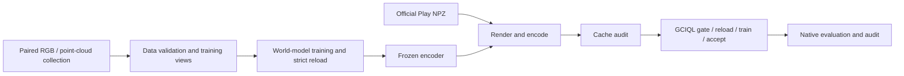

# JEPA4R — OGBench Cube

A single collection-to-control workflow for **Cube1–4** and six encoders. Select a model and Cube count; the same entry runs collection, training, frozen-feature encoding, GCIQL, and Native evaluation.

| Model switch | Encoder | Latent width | Initialization |
|---|---|---:|---|
| `jepa4r` / `lewm_pcd` | DexArt PointNet, XYZRGB | 192 | Train on paired point clouds |
| `lewm` / `lewm_rgb` | ViT-Tiny/14 | 192 | Train on paired images |
| `pldm` | Impala | 512 | Train on paired images |
| `lejepa` | ViT-Tiny/14 + head | 512 | Train on paired images |
| `visreg` | ViT-B/16, CLS | 768 | Released weights |
| `vjepa` | V-JEPA 2.1 ViT-L/16, patch mean | 1024 | Released weights |

## Setup

Use **Python 3.10** for world-model training and **Python 3.12** for policy learning. The environments are separate because the PLDM training factory and JAX have different Python requirements.

```bash
python3.10 -m venv /path/to/envs/worldmodel
python3.12 -m venv /path/to/envs/policy
/path/to/envs/worldmodel/bin/python -m pip install -r requirements/worldmodel.txt
/path/to/envs/policy/bin/python -m pip install -r requirements/policy.txt

export CUBE_WM_PYTHON=/path/to/envs/worldmodel/bin/python
export CUBE_RL_PYTHON=/path/to/envs/policy/bin/python
```

The pinned runtime uses PyTorch 2.8/CUDA 12.8, JAX 0.7.2, Flax 0.11.2 and MuJoCo 3.3.7. Headless rendering needs an EGL loader and an EGL-capable driver; on Debian/Ubuntu, install `libegl1` and `libopengl0`. Verify CUDA tensor operations and rendering before a run. The reference hardware is a 32GB CUDA GPU; full-size batches need substantially more memory than the interface tests.

## Minimal switch

Commands print a complete plan by default. Add `--execute` to run it.

```bash
python run.py --list

# Small end-to-end feasibility check.
python run.py --model jepa4r --cube-count 1 --mode smoke \
  --output /absolute/new/runs/cube1-jepa4r-smoke --execute

# The same interface selects another model/environment and formal budgets.
python run.py --model pldm --cube-count 4 --mode formal \
  --output /absolute/new/runs/cube4-pldm --execute
```

`--cube-count` accepts 1, 2, 3 or 4. `--model` accepts the switches above. `--stage` can select one stage; its default is `all`. A JSON `--config` can supply interpreter paths, input/cache roots and worker settings. Run outputs must use a new directory. `--resume` validates completed receipts and skips completed stages; failed attempts are retained and are never silently overwritten or dispatched twice. Model acceptance also has an explicit `--accept-only` utility under `bench.ogbench.fresh_train`.



VISReg and V-JEPA use released encoders, so their workflow prepares and verifies the selected release instead of collecting data or training a world model. Weights are downloaded only during explicit execution, or can be supplied through the `weights` config field. They are not included in this repository.

## Data and budgets

Collection produces RGB and point clouds from the **same simulator trajectories**. Each point cloud has 1,200 XYZRGB points; actions have five dimensions. Raw terminal observations are retained. Training views exclude terminal actions. Cube1–4 use 200, 500, 1,000 and 600 action-bearing rows respectively.

Formal collection uses 10,000 training and 1,000 independent validation episodes per Cube. The control mixture is low-noise expert 20%, high-noise expert 40%, expert-then-random 20%, and random 20%. Failed trajectories remain in the data. The collection seed is explicitly zero and each shard records its actual reset/policy seeds.

LeWM/JEPA4R train for 10 epochs with AdamW, learning rate `5e-5`, batch size 128 and BF16, using four observations at offsets `[0,5,10,15]`. PLDM and LeJEPA retain their method-specific recipes. All Cube settings use independent episode splits and training seed zero.

Policy learning uses the corresponding official Play train/validation NPZ archives. Their full SHA256 values are pinned in `official_sources.json`. These archives are a separate input from the collected world-model data. Formal GCIQL uses seed zero, batch size 1,024 and 1,000,000 updates; Native evaluation runs 50 episodes for each of the five official tasks. Visual current inputs have width `D+19`; goals have width `D+3N`, with no representation padding.

Smoke mode uses two collected training episodes and one validation episode, a bounded world-model run, the first complete 1,001-observation episode of each official split, a two-update GCIQL gate with independent reload, and one Native episode. Tiny keeps its valid native ten-epoch scheduler on this small input. A successful smoke demonstrates code execution and artifact compatibility; it does not certify benchmark success rates or formal training completion.

The [recorded CUDA smoke](SMOKE_VERIFICATION.json) completed the full JEPA4R/Cube1 path: 603 paired raw frames, two world-model updates and strict reload, 2,002 encoded official frames, cache audit, two GCIQL updates, independent reload, and one 200-step Native episode with 400 online encoder calls. All execution/audit stages exited zero. The untrained diagnostic policy succeeded in 0/1 episodes; this is an execution check, not a benchmark result. The full 24-combination formal matrix has not been run by this check.

Formal runs require considerable time and storage. Keep datasets, checkpoints and logs outside the source tree. Model/cache/checkpoint bindings are explicit; a missing input is reported rather than replaced with another model or dataset.

## Outputs and tests

Every stage saves its effective configuration, source/input hashes, logs, status and actual exit code. The final `PIPELINE_COMPLETE.json` is written after all requested stages produce successful, verified receipts. A PID or a checkpoint filename alone does not complete a run.

```bash
PYTHONPATH=lewm_pcd python -m pytest lewm_pcd/bench/ogbench/tests -q
```

`SOURCE_MANIFEST.json` pins executable sources and defaults. Runtime manifests bind data, model weights, preprocessing, camera geometry and policies to the actual run. Third-party code retains its upstream licenses; see the included license files and attribution notices.
