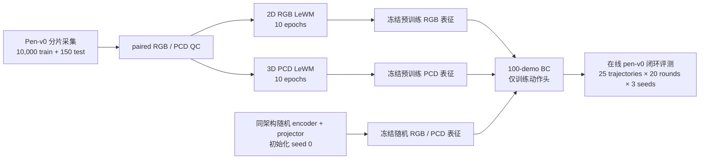
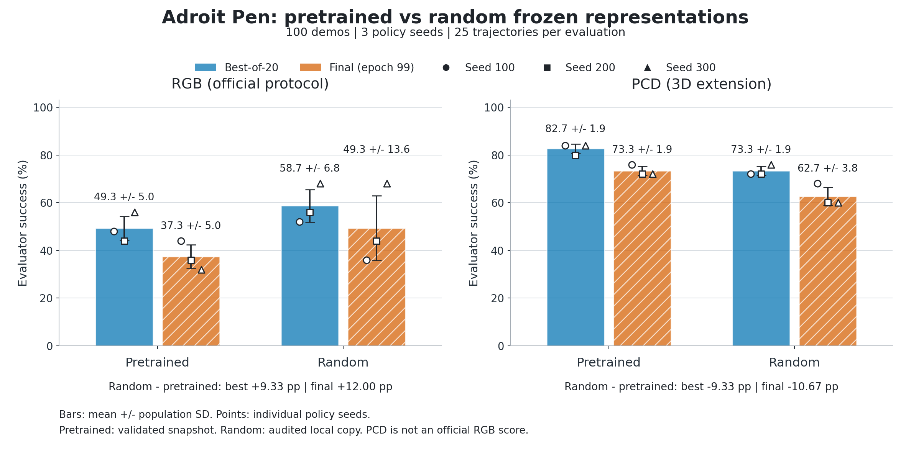
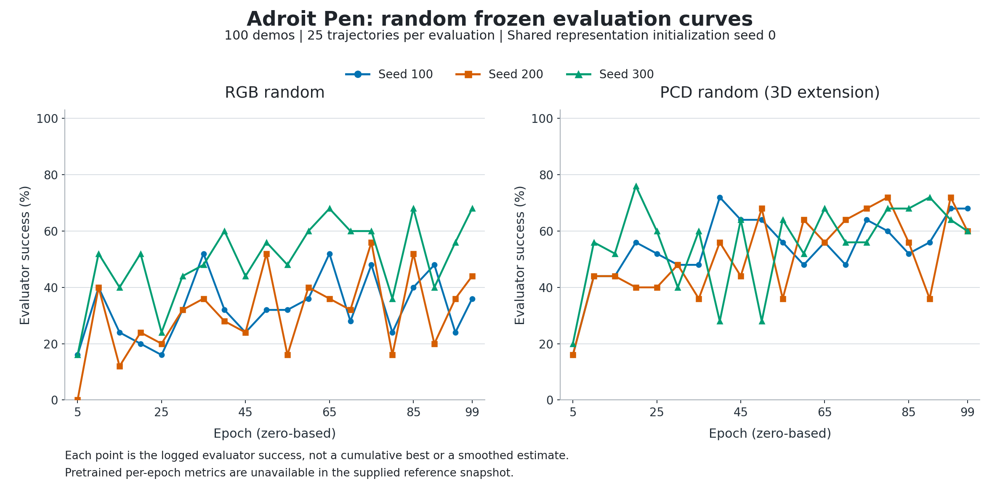

# CortexBench Adroit：Pen / Relocate 的 LeWM BC 结果

## 2026-10-06：Pen 新 paired 数据与完整三 seed 测评

本轮使用新的反馈专家混合 paired 数据完成 RGB／PCD 世界模型训练，再按当前 CortexBench 原循环执行 **100 demos／每轮25条轨迹／100 epochs** 的 Adroit BC。实际评测索引为 **5、10、…、95、99，共20轮**，原网络、FLARE、优化器、保存条件及旧任务代码保留。两路均为三帧192D特征加24D proprio（600D输入→24D动作）。PCD是独立模态扩展。

| seed | RGB Best-of-20 / Final | PCD Best-of-20 / Final |
|---|---:|---:|
| 100 | 36% / 24% | 80% / 76% |
| 200 | 44% / 32% | 76% / 76% |
| 300 | 32% / 24% | 88% / 68% |
| 三seed均值±总体std | **37.3±5.0% / 26.7±3.8%** | **81.3±5.0% / 73.3±3.8%** |

六个运行均已完成100轮、20轮真实评测，退出码0，loss有限。RGB seed300没有触发原最高reward策略保存条件，因此评分完整但没有该seed的策略文件；其余5个策略文件CPU重载及finite验证通过。Best-of-20 success与保存的最高reward策略是两种原有指标，未改保存规则。

独立的25步片段CEM扩展也已完成同50起点：RGB **34/50（68%）**、PCD **39/50（78%）**。目标=t+25笔位置／方向，距离<0.075m、dot>0.95且掉落失败；保留原5×5规划、50步预算、300/top30/10次迭代。50起点来自40个test episode，**23起点初始已达标**；初始未达标的27段分别为11/27、16/27。该结果不作为官方BC排行榜或规划器收益归因证据。

| 代码／验证范围 | 当前状态 |
|---|---|
| Pen paired采集→原2D/3D WM→官方BC→片段CEM | 本轮闭环代码、配置与验收证据已收录；依赖、数据、专家和权重需外部提供 |
| Relocate | 原代码、历史调试及结果保留；本轮未重跑，旧64个合成target点与本轮Pen可见target不同 |
| RM75-B／EG2 | 原分支前例保留，与RH56候选区分 |
| RM75＋RH56 | 独立本地候选有编译／渲染／运动接口证据，但目标／持握门禁失败；本次未作为任务就绪代码合入 |

[本轮代码清单、依赖锁和复现命令](docs/experiments/adroit_pen_paired_20261006.md) · [完整BC结果](docs/results/adroit_pen_20261006_paired_bc.json) · [CEM起点／偏置与结果](docs/results/adroit_pen_20261006_fragment_cem.json) · [世界模型验收](docs/results/adroit_pen_20261006_world_models.json)。下面保留2026-10-04及更早实验，不能与本轮不同数据／源码的结果混为同一对照。

## 历史记录（2026-10-04）

更新日期：**2026-10-04（Asia/Shanghai）**。本分支记录 Adroit 的 RGB 表征 BC 和独立的 3D PCD 扩展。BC 冻结 `encoder + projector`，训练动作头；这些结果不检验 WM predictor 或 MPC。下表汇总实际完成的 **100 demos / 每轮 25 条在线评测轨迹 / 100 epochs / 每 5 epochs 评测**运行，policy seeds 均为 `100/200/300`。

**Relocate 的新 target-aware PCD 预训练组与 RGB 预训练组已完成；Relocate 的匹配随机对照尚未完成。Pen 已有四组完整结果。** Relocate PCD 每帧额外注入由模拟器 `target_pos` 构造的 64 个目标 site 点，这个目标信息接口与 RGB 不同，不能将两组差值解释为纯粹的 3D 优势或预训练收益。

## 结果总表

主指标是每个 seed 的 **Best-of-20 success**；Final 为 epoch 99 的日志 success。以下数字均为百分比，均值和总体标准差按三个 seed 等权计算（`ddof=0`）。Best-of-20 在同一评测集上选择最高值，不是独立 holdout 成绩。

| 任务 | 模态与初始化 | Seed 100 best / final | Seed 200 best / final | Seed 300 best / final | Best-of-20 均值 ± std | Final 均值 ± std |
|---|---|---:|---:|---:|---:|---:|
| Relocate | RGB，预训练冻结 | 8% / 0% | 8% / 0% | 8% / 4% | **8.00% ± 0.00%** | 1.33% ± 1.89% |
| Relocate | target-aware PCD 扩展，预训练冻结 | 76% / 76% | 84% / 80% | 72% / 72% | **77.33% ± 4.99%** | 76.00% ± 3.27% |
| Pen | RGB，预训练冻结 | 48% / 44% | 44% / 36% | 56% / 32% | **49.33% ± 4.99%** | 37.33% ± 4.99% |
| Pen | RGB，随机初始化冻结 | 52% / 36% | 56% / 44% | 68% / 68% | **58.67% ± 6.80%** | 49.33% ± 13.60% |
| Pen | PCD 扩展，预训练冻结 | 84% / 76% | 80% / 72% | 84% / 72% | **82.67% ± 1.89%** | 73.33% ± 1.89% |
| Pen | PCD 扩展，随机初始化冻结 | 72% / 68% | 72% / 60% | 76% / 60% | **73.33% ± 1.89%** | 62.67% ± 3.77% |

RGB 使用官方任务与 RGB demo 协议；这不是官方发布的 LeWM 分数。PCD 为模拟器扩展，**不属于官方 RGB leaderboard**。Pen 和 Relocate 的任务、成功定义与训练分布不同，不能用跨任务差值评估实现正确性。

| 验收范围 | 状态与边界 |
|---|---|
| Relocate 预训练 RGB / 新 target-aware PCD | 六个有效 seed 的原始 metrics、配置、state、exit 和 policy SHA 已于 2026-10-04 只读复核；每个 seed 为 100 条 finite loss、20 条 finite eval，最后 eval epoch 99 |
| Relocate RGB 原 v2 seed 300 | **原 launcher 失败，exit 1**，缺少唯一 `best_policy.pickle`；表中采用独立 repair root 的 seed 300，原失败记录保留 |
| Relocate 随机 RGB / target-aware PCD | **尚无可验收的三 seed 匹配结果**；旧 `bc_tracks/3d_random` 已中止且使用旧 PCD demos，不纳入主表 |
| Pen 四组 | 本次只读复核 12 个运行的原始 metrics、配置、state、exit、validation 和小型 policy SHA；不重跑训练、在线评测或 policy reload |
| Pen 25 demos / 100 eval | 单 epoch smoke，与上表 100/25 正式运行分开；不作为正式结果或新增预训练收益证据 |

**结果评估：** Relocate target-aware PCD 在当前目标接口下获得较高 success，但缺少同目标接口的随机对照，尚不能归因于 WM 预训练。Relocate RGB 的低 success 已由完整日志确认；其根因尚未确定。Pen 同模态对照中，PCD 预训练较随机高 `9.33` 个百分点，RGB 预训练较随机低 `9.33` 个百分点；这只覆盖一个固定随机表征初始化，不支持普遍的预训练或模态优势结论。

结构化证据：[Relocate 六 seed 指标与验收快照](docs/results/adroit_relocate_100demo_20261004.json) · [Pen 完整随机对照](docs/results/adroit_pen_100demo_random_control.json) · [Pen 本次发布核对](docs/results/adroit_pen_release_audit_20261004.json)。Relocate 快照包含原始 metrics、配置、各文件 SHA、policy SHA、旧失败 launcher 和已中止随机链；本次只读重新计算指标与文件 hash，没有重新执行仿真或加载 policy。

**历史数字说明：** `/autodl-fs/data/lewm/cortexbench-adroit-pen-audit-20260929-v1/AUDIT.md` 中 RGB Final `16/24/28%`、PCD Final `52/68/60%` 对应旧 **25 demos / 25 eval** 配置，不与本表 100/25 混用。旧结果保留在 [Pen 25-demo 历史记录](docs/experiments/adroit_pen_25demo_history.md)。25/25 历史、100/25 正式结果和 25/100 单 epoch smoke 是三套不同协议。

## Relocate 输入与训练

任务为 `relocate-v0`；单步 action / BC proprio 为 `30D / 30D`，native state 为 `39D`，horizon 为 200，camera 为 `vil_camera`。BC 为三帧 FLARE 融合、192D 表征和 `(256,256,256)` BatchNormMLP 动作头；MSE、Adam、`lr=0.001`、batch 256。encoder/head 在 CUDA，MJRL/MuJoCo policy rollout 在 CPU；不要将整张 GPU 的利用率当作编码器负载。

```text
RGB 256x256 -> resize224/ImageNet -> frozen encoder + projector
PCD 1200x6 -> scene points + 64 explicit target-site points -> frozen PointNet + projector
3-frame FLARE + current proprio -> BC head -> current raw 30D action -> environment step
```

WM 使用 `frameskip=5`，所以 Relocate 的 action encoder 输入为五个单步动作拼接的 150D；**BC 输出仍为单步 30D**。BC 只使用表征，不调用动力学 predictor。

| 上游阶段 | 已有验收证据 |
|---|---|
| RGB v6 | 原 RGB 数据线保留，10 epoch checkpoint；strict reload、真实数据 encode/predict/loss finite 和 BC embedding loader 报告保留 |
| 新 target-aware PCD v3 | 10,000 train + 150 test episodes；各 200 步，共 2,000,000 / 30,000 行；训练 seeds `3072–13071`，测试 seeds `2000000–2000149` |
| PCD 全量 target-contract QC | 两个 split 的全部行检查 paired fields、offset、seed、finite 和固定 64 target 点尾部；unique seed / initial-state 均匹配 episode 数；保留 VDS 引用的 shards |
| Held-out replay | 抽查 test episodes `0/7/2`，覆盖 sample types `0/1/2`，共 600 步；不是全部 150 episodes 的 replay 验证 |
| PCD WM v2 target-aware | 10 epochs、batch128、BF16；只缓存 action/observation，12 workers、prefetch2、persistent workers；strict state_dict reload 无 missing/unexpected keys，真实数据和 CortexBench PCD loader finite |

target-aware 点云由场景 XYZRGB 与模拟器目标坐标生成的目标点组成。目标 site 点即使遮挡也会注入，属于显式目标信息；原几何 segmentation 过滤掉 site 的旧 PCD 和失败 root 均保留。两条 WM 数据线不同，不能称为严格的同数据模态对照。VDS HDF5 的 SHA 仅覆盖虚拟文件本身，完整溯源还需要 source manifest 和全部 shard。

## Relocate RGB 低 SR 排查

**已验证：** 官方 raw actions 与 target-aware BC demo actions 的 20,000 行逐元素一致。前 3 条 demo 的 `state[t] -> action[t] -> state[t+1]` 重放最大误差约 `7.8e-15`。正式 RGB 使用官方 raw demo；把 action 预先裁剪到 `[-1,1]` 会改写 `90.05%` 的行和 `5.13%` 的元素，即使环境内部裁剪使重放状态相同，也不能用 clipped probe 替代正式 BC 标签。

**有抽样证据：** RGB stored-vs-render audit 检查 3 demos 的前 3 帧，vertical flip 后约 99.6% 像素元素相等。该脚本直接写入 PASS，没有数值阈值断言；此结果只支持抽查帧的方向与状态对应，不能写成全量 RGB/embedding 一致性通过。另有 18 张实际 WM train/test 与 BC demo 图像的检查，目标绿色 site 在样本中存在；不能把旧 PCD 缺目标的问题套到 RGB。

**尚未验证：** 原 WM 与 BC 重建 encoder 的特征一致性、离线 batch 与在线 single-frame 一致性、旧 CPU 与新 CUDA 栈的等价性，以及 encoder 的目标位置敏感性。WM/BC resize 核不同，Pen 历史与 Relocate 本次环境也不同，这些差异的因果影响尚未验证。低训练 MSE、finite loss 和无 OOM 都不能证明 BC 闭环正确。

保存的 `best_policy.pickle` 按 **reward** 选取，Best-of-20 表格按 **success** 统计，二者可能对应不同 epoch。RGB seed 300 repair 修复的是保存完整性，没有提高其最高 success。现有 `train/success` 还存在复用 eval paths 的逻辑，不能当作独立的训练初态闭环测试。

只读检查报告：[Pen / Relocate RGB 流程对齐](docs/experiments/adroit_relocate_rgb_alignment_20261004.md) · [实际 RGB target 可见性抽查](docs/experiments/adroit_relocate_rgb_target_visibility_20261004.md)。报告中的建议为未执行的诊断，不属于新增实验结果。

对应发布证据：[流程审计的原始来源快照](docs/results/adroit_relocate_rgb_alignment_sources_20261004.json) · [像素/源码/颜色诊断来源与 SHA 索引](docs/results/adroit_relocate_rgb_target_sources_20261004.json) · [18 张实际输入帧](docs/figures/adroit_relocate_rgb_target_samples_20261004.png)。这些输入图像不是 BC policy rollout；索引明确标出仅在本地保存的其余素材。

## Relocate 产物与 SHA

以下相对路径以 `R=/root/autodl-tmp/workspace/users/lewm/adroit_full/relocate_official_10000_150_20261001_v1` 为根；它们是服务器位置，GitHub 不托管这些大型数据与权重。

| 产物 | 路径 |
|---|---|
| 官方 RGB BC demos | `/autodl-fs/data/lewm/cortexbench-official-data/adroit/relocate-v0.pickle` |
| target-aware BC demos | `R/bc_target_demo_v1/relocate-v0.pickle` |
| PCD v3 数据、manifest、shards、QC | `R/pcd_target_recollect_10000_150_v3` |
| RGB epoch-10 checkpoint | `R/wm_full_rgb_v6_shortcache/stablewm_home/checkpoints/relocate_rgb_full_v6_shortcache/weights_epoch_10.pt` |
| PCD epoch-10 checkpoint | `R/wm_full_pcd_v2_targetaware/stablewm_home/checkpoints/relocate_pcd_v2_targetaware/weights_epoch_10.pt` |
| 有效 RGB seeds 100/200 | `R/bc_formal_rgb_cuda_v2` |
| 有效 RGB seed 300 | `R/bc_formal_rgb_cuda_repair_seed300_v1` |
| 有效 PCD seeds 100/200/300 | `R/bc_formal_pcd_target_cuda_v5` |
| 采集与 BC 代码快照 | `R/recollect_code_target_v1/lewm_pcd` |
| 动作 / 图像审计 | `R/bc_2d_action_alignment_audit_20261004_retry2/report.json`；`R/bc_2d_rgb_image_alignment_audit_20261004/report.json` |

| 文件 | SHA256 |
|---|---|
| 官方 raw BC demo（记录值，本次未重 hash 4.21GB 文件） | `c71c7af5dda7b9a3d133a7e2baaa821bfe1ab7c4445dfde5624b947d13865694` |
| target-aware BC demo（记录值） | `20f89b7ab855b259f1efd0a96e11d48c398838ea62a3a86a4a0b68cdfea0e6bd` |
| RGB epoch-10 checkpoint（本次重新 hash） | `4ea58e8eedab77acc2d4621213f85547f29f1221a83ae3504701cab13a45519b` |
| PCD epoch-10 checkpoint（本次重新 hash） | `461321a3bd11a8e72f5b7d08064099b2288bbfa24383a4dc38c1f802ebf32f33` |

此次发布包含 README 和小型结果/审计文件；当前未提交的研究代码已单独备份，运行代码快照仍以服务器记录为准。2026-10-04 检查时 `/autodl-fs/data` 已满，尚不能宣称已完成该盘上的全量数据备份。两个 Relocate WM checkpoint 与六份有效 BC policy 另存本地并核对 SHA；完整数据仍在原实验 root，保留 shards，不删除旧实验。

## Pen-v0：100-demo IL 与随机初始化对照

本节保留 `cortexbench-adroit` 分支的 Pen-v0 数据、LeWM 训练和已验收的 **100-demo BC 在线评测**。截至 2026-10-01，2D RGB、3D PCD 的预训练表征与同架构随机初始化表征各完成 seeds `100/200/300`，共 12 个正式运行。主指标为每个 seed 的 **Best-of-20 success**，同时报告最后一轮 success。

本轮的关键观察：**2D 预训练组没有超过随机初始化组；3D PCD 预训练组比随机初始化组高 9.3 个百分点**。该对照检验冻结表征对 IL 的贡献；BC 使用 `encoder + projector`，不调用 WM 动力学 predictor。**PCD 是 3D 扩展，保留与官方 RGB 结果的区别。**

## 实验流程



## 数据与世界模型

| 阶段 | 已验证结果 |
|---|---|
| 数据采集 | 10,000 train + 150 test episodes；训练 seed 范围 `3072–13071`，测试 seed 范围 `2000000–2000149` |
| paired QC | train 两种模态各 901,470 行；test 各 13,349 行；episode offset/length、action 和 metadata 配对一致，PCD XYZ finite |
| train episode 长度 | 27–100 steps；test 为 28–100 steps；保留 expert/noisy、branch-random 和 random-action 轨迹，不按成功率过滤 |
| 2D LeWM | 10 epochs，完成；epoch-10 checkpoint 可用于官方 RGB BC |
| 3D Point-LeWM | 10 epochs，完成；epoch-10 checkpoint 用于 PCD BC 扩展 |

数据契约：RGB 为 `256×256×3`；PCD 为每帧 `1200×6`（世界坐标 XYZ，米；RGB，0–255）；action 维度 24；native state 维度 45；BC 使用的 proprio 维度 24。Adroit 相机为 `vil_camera`，点云由深度/分割反投影、前景裁剪和 5 mm voxel 去重得到。当前 PCD 属于单视角模拟器扩展，点云提取使用模拟器 segmentation，不等同真实传感器评测。

### 点云可视化

下方 GIF 在 README 中直接播放 seed 0 的 100 帧 RGB 与 XYZRGB 点云采样预览，**仅用于检查几何，不是策略 rollout 成绩**。

[](docs/figures/adroit_pen_100_frame_preview.gif)


完整旋转交互版保留在 [`docs/visualizations/adroit_pen_100_frame_preview.html`](docs/visualizations/adroit_pen_100_frame_preview.html)；它约 14 MB，GitHub 网页端可能不提供 HTML 预览。README 内嵌 GIF 可直接浏览全部 100 帧。

## 下游 IL 协议

采用 [CortexBench 官方 Adroit BC 配置](https://github.com/facebookresearch/eai-vc/blob/76fe35e87b1937168f1ec4b236e863451883eaf3/cortexbench/mujoco_vc/visual_imitation/config/Adroit_BC_config.yaml)：**100 demos 训练、100 epochs、`eval_frequency=5`、每轮 25 条在线 evaluator trajectories**。评测位于 epoch `5, 10, ..., 95, 99`，每个 seed 共 20 轮。测试是策略在 `pen-v0` 中 reset 后执行 action 的闭环 rollout，不是另用 100 条离线 demos 测试。

2D 使用官方 RGB demos；3D 将同一组官方 100 条 Pen demos 按原 action 重放并转换成 PCD。10,000 条 paired episodes 用于上游 LeWM 训练，与下游 BC 的 100 条 expert demos 是两组数据。

预训练和随机组在各自模态内保持架构、预处理、192 维 latent、FLARE 三帧融合、24 维 proprio、24 维 action 和 BC 优化器相同。冻结 `encoder + projector`，仅训练 `(256, 256, 256)` 动作头；使用 MSE、Adam、`lr=0.001`、batch size 256、CPU FP32。随机组同时随机初始化 encoder 和 projector，使用原生初始化及归一化层默认值，初始化 seed 固定为 `0`。

## 100-demo 成绩

以下均为在线 evaluator success；三个 policy seeds 等权统计，`std` 是总体标准差（`ddof=0`），不是置信区间。

| 轨道 | Seed 100 best / final | Seed 200 best / final | Seed 300 best / final | **Best-of-20 均值 ± std** | Final 均值 ± std |
|---|---:|---:|---:|---:|---:|
| LeWM 2D RGB，预训练冻结 | 48% / 44% | 44% / 36% | 56% / 32% | **49.3% ± 5.0%** | 37.3% ± 5.0% |
| LeWM 2D RGB，随机初始化冻结 | 52% / 36% | 56% / 44% | 68% / 68% | **58.7% ± 6.8%** | 49.3% ± 13.6% |
| LeWM 3D PCD，预训练冻结 | 84% / 76% | 80% / 72% | 84% / 72% | **82.7% ± 1.9%** | 73.3% ± 1.9% |
| LeWM 3D PCD，随机初始化冻结 | 72% / 68% | 72% / 60% | 76% / 60% | **73.3% ± 1.9%** | 62.7% ± 3.8% |



柱为三 seed 均值，点为各 seed；误差线为总体标准差。图中 RGB 与 PCD 分开展示，同模态内才构成匹配对照。

| 模态 | 预训练 − 随机：Best-of-20 | 预训练 − 随机：Final |
|---|---:|---:|
| 2D RGB | **−9.3 个百分点** | −12.0 个百分点 |
| 3D PCD 扩展 | **+9.3 个百分点** | +10.7 个百分点 |



曲线展示随机组每轮 success，横轴为实际 epoch。最高值用于 Best-of-20，末点用于 Final；20 轮沿用每个 policy seed 的 evaluator reset seed 集，并不是 20 个独立训练 seed。

12 个正式运行均已验收：每个 seed 100 条 finite loss、20 条 finite eval、最终 epoch 99、`exit_code=0`、policy 可加载、SHA 与记录匹配、配置与数据契约通过。随机流程于 **2026-10-01 22:22（Asia/Shanghai）** 完成，监控已结束。完整数值与溯源见 [结构化结果](docs/results/adroit_pen_100demo_random_control.json) 和 [实验记录](docs/experiments/adroit_pen_100demo_random_control.md)。

此前 README 中的 25-demo 主表已由本轮 100-demo 表替换；旧结果与运行目录保留在 [历史 25-demo 记录](docs/experiments/adroit_pen_25demo_history.md)。

## 公开结果对照

下表仅列公开参考：BC-IB 论文 Table 6 的 **Reorient-Pen** RGB 任务，100 demos、25 条评测轨迹、3 seeds。已核对 PDF 第 19 页的 task-wise 数值，以及第 6、17、18 页的训练与选模设定。论文使用不同的融合网络、优化设置，部分 ResNet/ViT 基线还训练编码器；因此不与我们的冻结 LeWM 组组成严格匹配榜单。我们没有在本轮重跑 VC-1/R3M 等正式基线。

| 公开方法（BC-IB Table 6） | 成功率 |
|---|---:|
| ResNet + IB | 69.33% |
| ResNet | 65.33% |
| ViT + IB | 64.00% |
| ViT | 61.33% |
| MPI + IB | 61.33% |
| MPI | 60.00% |
| R3M + IB | 52.00% |
| R3M | 45.33% |
| VC-1 | 38.67% |
| VC-1 + IB | 37.33% |
| Voltron + IB | 38.67% |
| Voltron | 32.00% |

原始 VC-1 CortexBench 论文的 `Adroit` 列是 **Reorient-Pen 与 Relocate 的 benchmark-level 汇总**，不是 Pen 单任务数值；因此这里用后续论文的 task-wise Reorient-Pen 表作参考，避免把不同粒度的数字混在一起。[BC-IB Table 6](https://raw.githubusercontent.com/mlresearch/v267/main/assets/bai25e/bai25e.pdf) · [原始 CortexBench / VC-1 论文](https://papers.nips.cc/paper_files/paper/2023/file/022ca1bed6b574b962c48a2856eb207b-Paper-Conference.pdf)

## 结论与限制

- **已验证：** 在本次 Pen 冻结表征 IL 设置下，3D 预训练组在三个 policy seed 的 Best-of-20 均高于对应随机组，均值差为 `+9.3` 个百分点。随机 PCD 自身也达到 `73.3%`，说明较高 SR 不能全部归因于 WM 预训练。
- **已验证：** RGB 随机组的 Best-of-20 在三个 policy seed 均高于预训练组，均值差为 `+9.3` 个百分点；本轮没有提供 RGB 预训练收益的证据。
- **尚未验证：** 跨编码器初始化的稳定性、显著性、跨任务迁移、动力学 predictor 或 MPC 收益。当前仅有一个固定随机 encoder seed；三个 policy seed 同时影响动作头训练与 evaluator reset 集，不能隔离这两类方差。
- Best-of-20 在评测集上选最高值，会有选择偏差；每轮 25 条轨迹的分辨率为 4 个百分点。Final 是同一评测集末轮结果，不是新的独立 holdout。`best_policy.pickle` 按 return 在保存点选取，未必对应最高 success。
- PCD 额外使用深度几何与模拟器分割，信息量不同于 RGB；未做 proprio-only 对照，无法量化手部状态、几何和随机架构各自的贡献。现有上游 150 条 test episodes 也不是此 BC 成绩的在线测试集。
- 已验收运行使用 Python 3.8.20、PyTorch 1.13.0 CPU、torchvision 0.14.0、mujoco-py 2.0.2.13；GPU 统计包含渲染与同机其他进程，不能用全卡利用率描述 BC 编码器训练负载。

## 主要产物

| 产物 | 服务器路径 |
|---|---|
| paired 10k/150 数据与 QC | `/root/autodl-tmp/workspace/users/lewm/adroit_full/pen_official_10000_150_20260927` |
| 100-demo 预训练 RGB BC | `/autodl-fs/data/lewm/cortexbench-adroit-pen-official-100demo-rgb-20260929-v1/lewm_adroit_pen_2d` |
| 100 条 PCD demos 与转换 QC | `/autodl-fs/data/lewm/cortexbench-adroit-pen-pcd-demos-20260929-v1` |
| 100-demo 预训练 PCD BC | `/autodl-fs/data/lewm/cortexbench-adroit-pen-pcd-bc-100demo-20260930-v1/pcd_100demo_formal` |
| 100-demo 随机 RGB / PCD BC 与 smoke | `/root/autodl-tmp/workspace/users/lewm/cortexbench-adroit-pen-random-control-100demo-20261001-v1` |

随机组使用用户授权的 `autodl-tmp` 盘，state、config、metrics、log、policy 与随机表征快照已同步本地 `artifacts/pen_random_control_20261001/results`。仓库仅包含代码、配置、结构化结果和图表；大型数据、权重和运行日志继续保存于上述实验目录。
