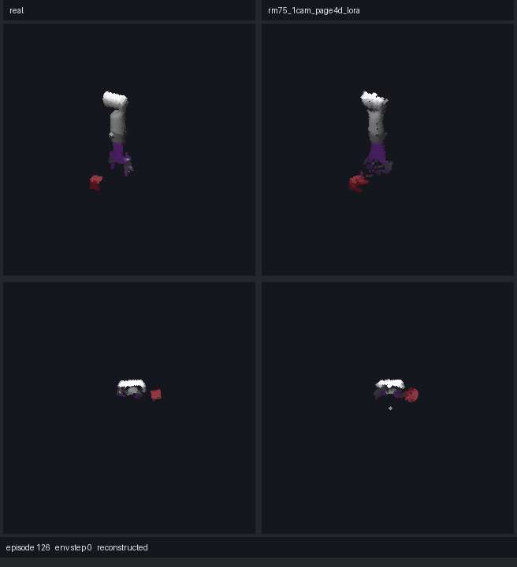
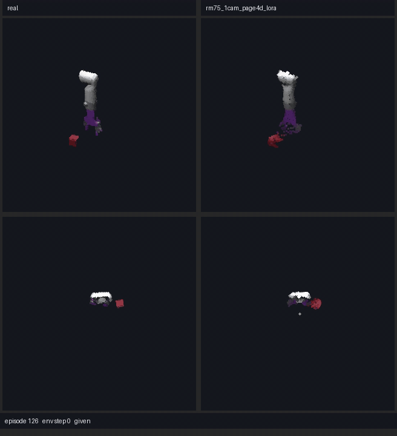
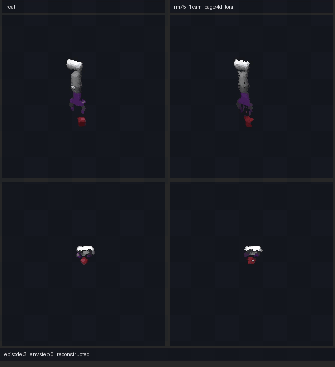
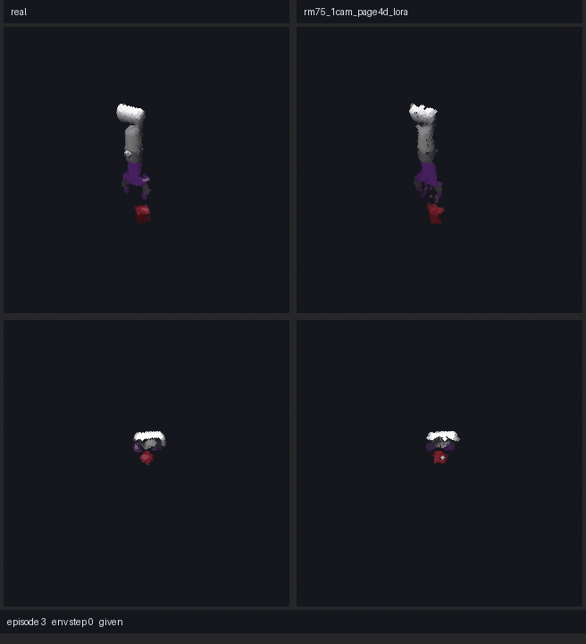
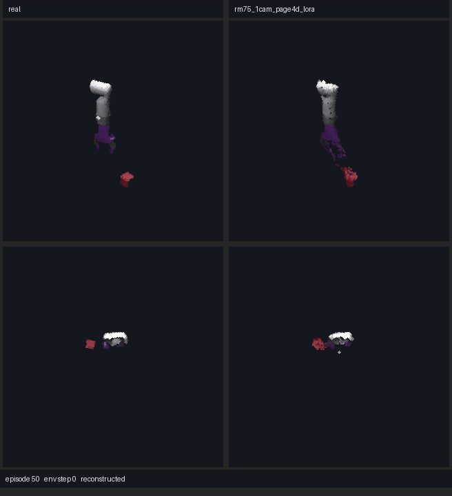
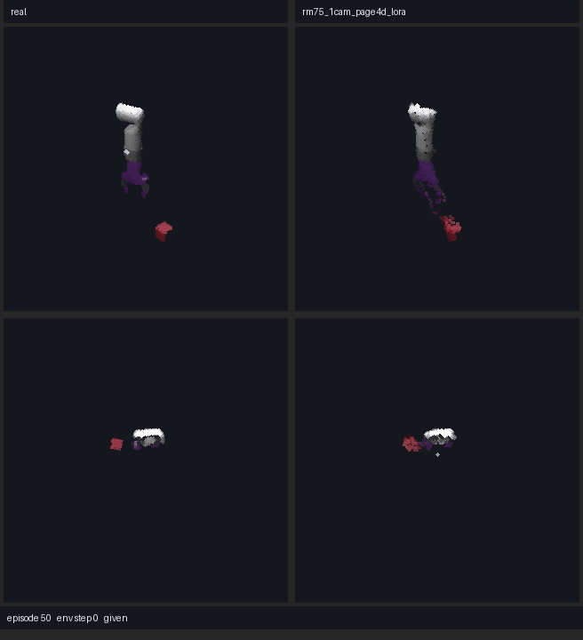
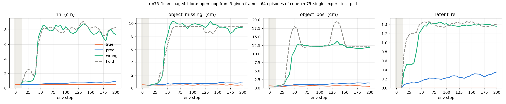

# JEPA4R

## 点云重建效果：冻结的点云 JEPA 世界模型 + PAGE-4D 初始化的前馈重建头

RealMan RM75-B 机械臂上的 OGBench cube 任务，点云来自单台深度相机。世界模型（3D 点云 JEPA，DexArt encoder）全程冻结，只取它每一帧的 latent（192 维）；
重建头用 PAGE-4D 的预训练权重初始化，先只训新加的部分，再在全部 72 个注意力块的 q / v 上加 rank-4 LoRA。每帧一次前向出 1200 个点，不做逐场景优化。
下面的视频和读数都来自测试集：单独采集的 1000 个回合，世界模型和重建头训练时都没见过。
方法、命令和全部读数见 [`lewm_pcd/README.md`](lewm_pcd/README.md) 的「结果」和「3D 重建」两节。

每个视频里：左 = 真实点云，右 = 重建；上 = 斜视，下 = 俯视。白色是机械臂，紫色是夹爪，红色是方块。

| 测试集回合 | 逐帧重建：每一帧单独编码、解码 | 开环预测：只给前 3 帧，之后的 latent 全由世界模型按记录的动作推出，再解码 |
|---|---|---|
| 126 |  |  |
| 3 |  |  |
| 50 |  |  |

- 单帧（测试集随机 4096 帧）：双向最近邻平均 0.50 cm（p90 0.57 cm），离群点 0.39 %，方块位置误差 0.61 cm。
- 开环（测试集前 64 个回合，给前 3 帧）：整体误差在 env 步 15 / 100 / 200 为 0.48 / 0.65 / 0.87 cm（用真实 latent 解码是 0.48 / 0.48 / 0.49 cm），方块位置误差 0.56 / 1.04 / 1.47 cm；
  换成另一回合的动作，或一直停在最后一个给定帧，误差到 7.3–8.4 cm。

开环误差曲线（测试集 64 个回合的平均）：橙 = 真实 latent 的解码，蓝 = 开环预测，绿 = 换成另一回合的动作，灰虚线 = 停在最后一个给定帧；灰底是给定的 3 帧。

### 原版 UR5e（OGBench Cube-Single）

同样的做法用在 OGBench Cube-Single 原版的 UR5e 机械臂上（单台深度相机，世界模型在这份数据上训）。单帧读数用 4096 个验证帧（与训练帧来自同一批回合），开环读数取训练数据的前 64 个回合；全部读数见 [`lewm_pcd/README.md`](lewm_pcd/README.md) 的「结果」一节。

- 单帧：双向最近邻平均 0.79 cm（p90 0.94 cm），离群点 2.89 %，方块位置误差 1.05 cm。
- 开环（给前 3 帧）：整体误差在 env 步 15 / 100 / 200 为 0.75 / 0.85 / 0.89 cm（用真实 latent 解码是 0.75 / 0.80 / 0.74 cm），方块位置误差 0.92 / 1.10 / 1.39 cm；
  换成另一回合的动作，第 100 / 200 步误差 13.23 / 11.46 cm。

| 解码器（只换预训练模型） | 单帧双向最近邻 | 单帧方块位置 | 开环第 200 步 |
|---|---|---|---|
| PAGE-4D（默认） | 0.79 | 1.05 | 0.89 |
| VGGT | 0.79 | 1.01 | 0.88 |
| Depth Anything 3 | 0.75 | 0.94 | 0.85 |
