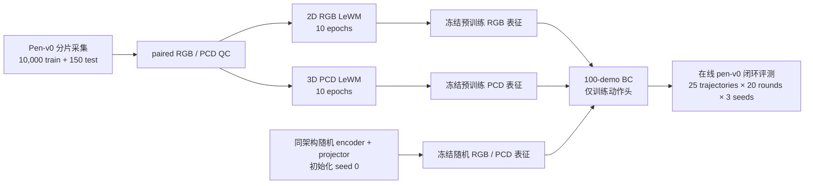

# CortexBench Adroit Pen-v0：100-demo IL 与随机初始化对照

本页记录 `cortexbench-adroit` 分支的 Pen-v0 数据、LeWM 训练和已验收的 **100-demo BC 在线评测**。截至 2026-10-01，2D RGB、3D PCD 的预训练表征与同架构随机初始化表征各完成 seeds `100/200/300`，共 12 个正式运行。主指标为每个 seed 的 **Best-of-20 success**，同时报告最后一轮 success。

本轮的关键观察：**2D 预训练组没有超过随机初始化组；3D PCD 预训练组比随机初始化组高 9.3 个百分点**。该对照检验冻结表征对 IL 的贡献；BC 使用 `encoder + projector`，不调用 WM 动力学 predictor。**PCD 是 3D 扩展，保留与官方 RGB 结果的区别。**

## 实验流程

## 数据与世界模型

| 阶段 | 已验证结果 |
|---|---|
| 数据采集 | 10,000 train + 150 test episodes；训练 seed 范围 `3072–13071`，测试 seed 范围 `2000000–2000149` |
| paired QC | train 两种模态各 901,470 行；test 各 13,349 行；episode offset/length、action 和 metadata 配对一致，PCD XYZ finite |
| train episode 长度 | 27–100 steps；test 为 28–100 steps；保留 expert/noisy、branch-random 和 random-action 轨迹，不按成功率过滤 |
| 2D LeWM | 10 epochs，完成；epoch-10 checkpoint 可用于官方 RGB BC |
| 3D Point-LeWM | 10 epochs，完成；epoch-10 checkpoint 用于 PCD BC 扩展 |

数据契约：RGB 为 `256×256×3`；PCD 为每帧 `1200×6`（世界坐标 XYZ，米；RGB，0–255）；action 维度 24；native state 维度 45；BC 使用的 proprio 维度 24。Adroit 相机为 `vil_camera`，点云由深度/分割反投影、前景裁剪和 5 mm voxel 去重得到。当前 PCD 属于单视角模拟器扩展，点云提取使用模拟器 segmentation，不等同真实传感器评测。

### 点云可视化

下方 GIF 在 README 中直接播放 seed 0 的 100 帧 RGB 与 XYZRGB 点云采样预览，**仅用于检查几何，不是策略 rollout 成绩**。

完整旋转交互版保留在 [`docs/visualizations/adroit_pen_100_frame_preview.html`](docs/visualizations/adroit_pen_100_frame_preview.html)；它约 14 MB，GitHub 网页端可能不提供 HTML 预览。README 内嵌 GIF 可直接浏览全部 100 帧。

## 下游 IL 协议

采用 [CortexBench 官方 Adroit BC 配置](https://github.com/facebookresearch/eai-vc/blob/76fe35e87b1937168f1ec4b236e863451883eaf3/cortexbench/mujoco_vc/visual_imitation/config/Adroit_BC_config.yaml)：**100 demos 训练、100 epochs、`eval_frequency=5`、每轮 25 条在线 evaluator trajectories**。评测位于 epoch `5, 10, ..., 95, 99`，每个 seed 共 20 轮。测试是策略在 `pen-v0` 中 reset 后执行 action 的闭环 rollout，不是另用 100 条离线 demos 测试。

2D 使用官方 RGB demos；3D 将同一组官方 100 条 Pen demos 按原 action 重放并转换成 PCD。10,000 条 paired episodes 用于上游 LeWM 训练，与下游 BC 的 100 条 expert demos 是两组数据。

预训练和随机组在各自模态内保持架构、预处理、192 维 latent、FLARE 三帧融合、24 维 proprio、24 维 action 和 BC 优化器相同。冻结 `encoder + projector`，仅训练 `(256, 256, 256)` 动作头；使用 MSE、Adam、`lr=0.001`、batch size 256、CPU FP32。随机组同时随机初始化 encoder 和 projector，使用原生初始化及归一化层默认值，初始化 seed 固定为 `0`。

## 100-demo 成绩

以下均为在线 evaluator success；三个 policy seeds 等权统计，`std` 是总体标准差（`ddof=0`），不是置信区间。

| 轨道 | Seed 100 best / final | Seed 200 best / final | Seed 300 best / final | **Best-of-20 均值 ± std** | Final 均值 ± std |
|---|---:|---:|---:|---:|---:|
| LeWM 2D RGB，预训练冻结 | 48% / 44% | 44% / 36% | 56% / 32% | **49.3% ± 5.0%** | 37.3% ± 5.0% |
| LeWM 2D RGB，随机初始化冻结 | 52% / 36% | 56% / 44% | 68% / 68% | **58.7% ± 6.8%** | 49.3% ± 13.6% |
| LeWM 3D PCD，预训练冻结 | 84% / 76% | 80% / 72% | 84% / 72% | **82.7% ± 1.9%** | 73.3% ± 1.9% |
| LeWM 3D PCD，随机初始化冻结 | 72% / 68% | 72% / 60% | 76% / 60% | **73.3% ± 1.9%** | 62.7% ± 3.8% |

柱为三 seed 均值，点为各 seed；误差线为总体标准差。图中 RGB 与 PCD 分开展示，同模态内才构成匹配对照。

| 模态 | 预训练 − 随机：Best-of-20 | 预训练 − 随机：Final |
|---|---:|---:|
| 2D RGB | **−9.3 个百分点** | −12.0 个百分点 |
| 3D PCD 扩展 | **+9.3 个百分点** | +10.7 个百分点 |

曲线展示随机组每轮 success，横轴为实际 epoch。最高值用于 Best-of-20，末点用于 Final；20 轮沿用每个 policy seed 的 evaluator reset seed 集，并不是 20 个独立训练 seed。

12 个正式运行均已验收：每个 seed 100 条 finite loss、20 条 finite eval、最终 epoch 99、`exit_code=0`、policy 可加载、SHA 与记录匹配、配置与数据契约通过。随机流程于 **2026-10-01 22:22（Asia/Shanghai）** 完成，监控已结束。完整数值与溯源见 [结构化结果](docs/results/adroit_pen_100demo_random_control.json) 和 [实验记录](docs/experiments/adroit_pen_100demo_random_control.md)。

此前 README 中的 25-demo 主表已由本轮 100-demo 表替换；旧结果与运行目录保留在 [历史 25-demo 记录](docs/experiments/adroit_pen_25demo_history.md)。

## 公开结果对照

下表仅列公开参考：BC-IB 论文 Table 6 的 **Reorient-Pen** RGB 任务，100 demos、25 条评测轨迹、3 seeds。已核对 PDF 第 19 页的 task-wise 数值，以及第 6、17、18 页的训练与选模设定。论文使用不同的融合网络、优化设置，部分 ResNet/ViT 基线还训练编码器；因此不与我们的冻结 LeWM 组组成严格匹配榜单。我们没有在本轮重跑 VC-1/R3M 等正式基线。

| 公开方法（BC-IB Table 6） | 成功率 |
|---|---:|
| ResNet + IB | 69.33% |
| ResNet | 65.33% |
| ViT + IB | 64.00% |
| ViT | 61.33% |
| MPI + IB | 61.33% |
| MPI | 60.00% |
| R3M + IB | 52.00% |
| R3M | 45.33% |
| VC-1 | 38.67% |
| VC-1 + IB | 37.33% |
| Voltron + IB | 38.67% |
| Voltron | 32.00% |

原始 VC-1 CortexBench 论文的 `Adroit` 列是 **Reorient-Pen 与 Relocate 的 benchmark-level 汇总**，不是 Pen 单任务数值；因此这里用后续论文的 task-wise Reorient-Pen 表作参考，避免把不同粒度的数字混在一起。[BC-IB Table 6](https://raw.githubusercontent.com/mlresearch/v267/main/assets/bai25e/bai25e.pdf) · [原始 CortexBench / VC-1 论文](https://papers.nips.cc/paper_files/paper/2023/file/022ca1bed6b574b962c48a2856eb207b-Paper-Conference.pdf)

## 结论与限制

- **已验证：** 在本次 Pen 冻结表征 IL 设置下，3D 预训练组在三个 policy seed 的 Best-of-20 均高于对应随机组，均值差为 `+9.3` 个百分点。随机 PCD 自身也达到 `73.3%`，说明较高 SR 不能全部归因于 WM 预训练。
- **已验证：** RGB 随机组的 Best-of-20 在三个 policy seed 均高于预训练组，均值差为 `+9.3` 个百分点；本轮没有提供 RGB 预训练收益的证据。
- **尚未验证：** 跨编码器初始化的稳定性、显著性、跨任务迁移、动力学 predictor 或 MPC 收益。当前仅有一个固定随机 encoder seed；三个 policy seed 同时影响动作头训练与 evaluator reset 集，不能隔离这两类方差。
- Best-of-20 在评测集上选最高值，会有选择偏差；每轮 25 条轨迹的分辨率为 4 个百分点。Final 是同一评测集末轮结果，不是新的独立 holdout。`best_policy.pickle` 按 return 在保存点选取，未必对应最高 success。
- PCD 额外使用深度几何与模拟器分割，信息量不同于 RGB；未做 proprio-only 对照，无法量化手部状态、几何和随机架构各自的贡献。现有上游 150 条 test episodes 也不是此 BC 成绩的在线测试集。
- 已验收运行使用 Python 3.8.20、PyTorch 1.13.0 CPU、torchvision 0.14.0、mujoco-py 2.0.2.13；GPU 统计包含渲染与同机其他进程，不能用全卡利用率描述 BC 编码器训练负载。

## 主要产物

| 产物 | 服务器路径 |
|---|---|
| paired 10k/150 数据与 QC | `/root/autodl-tmp/workspace/users/lewm/adroit_full/pen_official_10000_150_20260927` |
| 100-demo 预训练 RGB BC | `/autodl-fs/data/lewm/cortexbench-adroit-pen-official-100demo-rgb-20260929-v1/lewm_adroit_pen_2d` |
| 100 条 PCD demos 与转换 QC | `/autodl-fs/data/lewm/cortexbench-adroit-pen-pcd-demos-20260929-v1` |
| 100-demo 预训练 PCD BC | `/autodl-fs/data/lewm/cortexbench-adroit-pen-pcd-bc-100demo-20260930-v1/pcd_100demo_formal` |
| 100-demo 随机 RGB / PCD BC 与 smoke | `/root/autodl-tmp/workspace/users/lewm/cortexbench-adroit-pen-random-control-100demo-20261001-v1` |

随机组使用用户授权的 `autodl-tmp` 盘，state、config、metrics、log、policy 与随机表征快照已同步本地 `artifacts/pen_random_control_20261001/results`。仓库仅包含代码、配置、结构化结果和图表；大型数据、权重和运行日志继续保存于上述实验目录。
