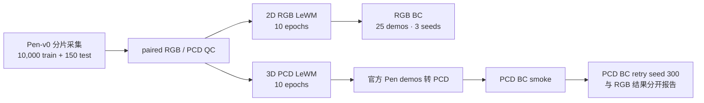
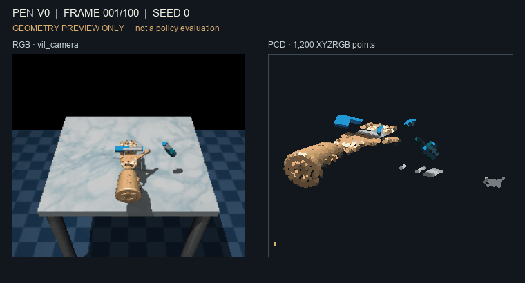
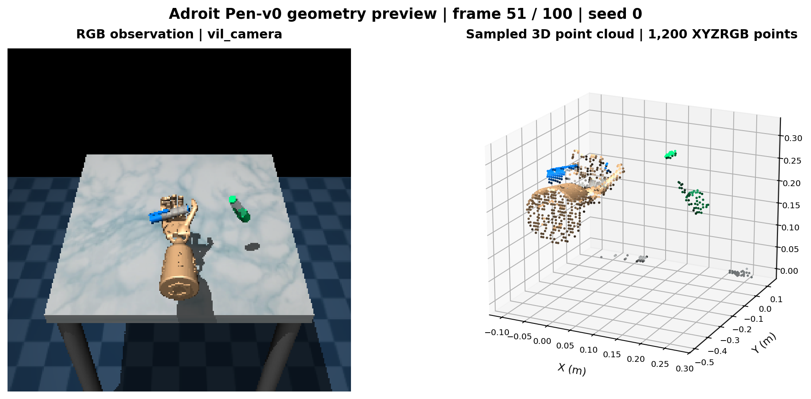
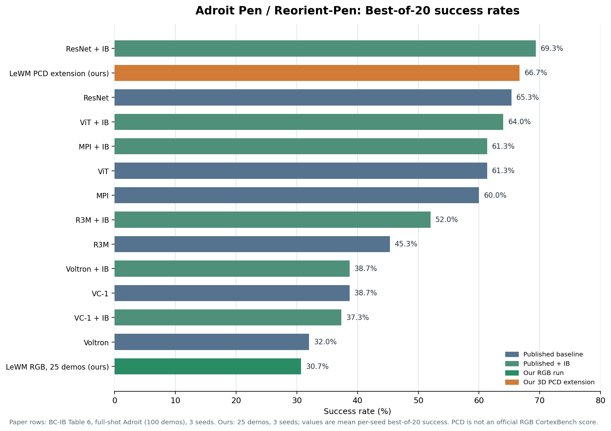

# CortexBench Adroit Pen-v0：已验证实验

本文记录本次在 `cortexbench` 分支完成的 Adroit Pen-v0 数据、世界模型和下游 BC 结果。数值来自持久化 metrics、QC/state 文件和最终 policy 校验。2D RGB 运行沿用 CortexBench 官方 RGB 观测与 BC/evaluator 路径，但本次用 25 demos；因此本地 RGB 数字也不冒充论文榜单复现。**3D PCD 是单独的扩展实验，不是官方 RGB 榜单成绩。**

## 实验流程

## 数据与世界模型

| 阶段 | 已验证结果 |
|---|---|
| 数据采集 | 10,000 train + 150 test episodes；训练 seed 范围 `3072–13071`，测试 seed 范围 `2000000–2000149` |
| paired QC | train 两种模态各 901,470 行；test 各 13,349 行；episode offset/length、action 和 metadata 配对一致，PCD XYZ finite |
| train episode 长度 | 27–100 steps；test 为 28–100 steps；保留 expert/noisy、branch-random 和 random-action 轨迹，不按成功率过滤 |
| 2D LeWM | 10 epochs，完成；epoch-10 checkpoint 可用于官方 RGB BC |
| 3D Point-LeWM | 10 epochs，完成；epoch-10 checkpoint 用于 PCD BC 扩展 |

数据契约：RGB 为 `256×256×3`；PCD 为每帧 `1200×6`（世界坐标 XYZ，米；RGB，0–255）；action 维度 24；native state 维度 45；BC 使用的 proprio 维度 24。Adroit 相机为 `vil_camera`，点云由深度/分割反投影、前景裁剪和 5 mm voxel 去重得到。当前 PCD 属于单视角模拟器扩展，点云提取使用模拟器 segmentation，不等同真实传感器评测。

### 点云可视化

下方 GIF 在 README 中直接播放 seed 0 的 100 帧 RGB 与 XYZRGB 点云采样预览，**仅用于检查几何，不是策略 rollout 成绩**。

完整旋转交互版保留在 [`docs/visualizations/adroit_pen_100_frame_preview.html`](docs/visualizations/adroit_pen_100_frame_preview.html)；它约 14 MB，GitHub 网页端可能不提供 HTML 预览。README 内嵌 GIF 可直接浏览全部 100 帧。

## 下游 BC 成绩

BC 配置：每个 seed 25 demos、100 epochs、每 5 epochs 评测、每次 25 条轨迹；seeds `100/200/300`。**主指标是每个 seed 在 20 次评测中的最高 success，再跨 seed 求均值和标准差**；最后一次 evaluator success 只作为次指标。均值按三个 seed 等权计算。

2D BC 使用官方 RGB demos；PCD BC 则把官方 100 条 Pen demos 按原 action 逐条重放并转换成 PCD，再从中取 25 条训练。10,000 条新采集 paired episodes 用于 LeWM 世界模型训练，不与 BC 的官方 demos 混为同一训练集。

| 轨道 | Seed 100 best / final | Seed 200 best / final | Seed 300 best / final | **Best-of-20 均值 ± std** | Final 均值 ± std |
|---|---:|---:|---:|---:|---:|
| LeWM 2D RGB | 28% / 16% | 32% / 24% | 32% / 28% | **30.7% ± 1.9%** | 22.7% ± 5.0% |
| LeWM 3D PCD 扩展 | 68% / 52% | 68% / 68% | 64% / 60% | **66.7% ± 1.9%** | 60.0% ± 6.5% |

所有 6 个 seed 均完成 100 loss records、20 evaluator records，进程退出码为 0，policy pickle 可加载。PCD retry seed 300 的输出在 `/autodl-fs/data/lewm/cortexbench-adroit-pen-pcd-bc-retry-seed300-run2-20260929-v1`。上述 PCD 结果单独标记，不并入 RGB 榜单。

## 公开结果对照

下图的论文行取自 BC-IB 论文 Table 6 的 **Reorient-Pen** 任务；论文对 Adroit 使用 100 demos、3 seeds。我们本次使用 25 demos，因此这张图用于结果定位，**不构成同配置排行榜或严格 apples-to-apples 对比**。本图的本次结果也统一使用 Best-of-20 主指标；PCD 更不是论文的 RGB 输入结果。

| 公开方法 / 本次轨道 | 成功率 |
|---|---:|
| ResNet + IB | 69.33% |
| ResNet | 65.33% |
| ViT + IB | 64.00% |
| ViT | 61.33% |
| MPI + IB | 61.33% |
| MPI | 60.00% |
| R3M + IB | 52.00% |
| R3M | 45.33% |
| VC-1 | 38.67% |
| VC-1 + IB | 37.33% |
| Voltron + IB | 38.67% |
| Voltron | 32.00% |
| **本次 LeWM 2D RGB，25 demos** | **30.7% Best-of-20 均值** |
| **本次 LeWM 3D PCD 扩展，25 demos** | **66.7% Best-of-20 均值** |

原始 VC-1 CortexBench 论文的 `Adroit` 列是 **Reorient-Pen 与 Relocate 的 benchmark-level 汇总**，不是 Pen 单任务数值；因此这里用后续论文的 task-wise Reorient-Pen 表作参考，避免把不同粒度的数字混在一起。[BC-IB Table 6](https://raw.githubusercontent.com/mlresearch/v267/main/assets/bai25e/bai25e.pdf) · [原始 CortexBench / VC-1 论文](https://papers.nips.cc/paper_files/paper/2023/file/022ca1bed6b574b962c48a2856eb207b-Paper-Conference.pdf)

## 结果解释与边界

- 本次验证了从 paired 数据采集、2D/3D LeWM 训练到 BC 评测的完整工程路径；各阶段保留了 state、metrics、配置、退出码和模型产物。
- 在本次 25-demo 设置下，PCD 扩展的 Best-of-20 均值高于 RGB 轨道；由于视觉模态、checkpoint 和论文 demo 数不同，这只说明本次实验观察到的差异，不能据此断言 PCD 普遍优于 RGB。
- 官方 legacy BC 环境是 CPU-only PyTorch；本次观测到训练进程约 199% CPU、GPU 峰值约 1%、RSS 峰值约 0.9 GiB。未为追求 GPU 利用率改变 MuJoCo 或 evaluator 协议。

## 主要产物

| 产物 | 服务器路径 |
|---|---|
| paired 10k/150 数据与 QC | `/root/autodl-tmp/workspace/users/lewm/adroit_full/pen_official_10000_150_20260927` |
| 2D RGB BC，seeds 100/200/300 | `/autodl-fs/data/lewm/cortexbench-adroit-pen-official-bc-2d-20260928-v2` |
| 100 条 PCD demos 与转换 QC | `/autodl-fs/data/lewm/cortexbench-adroit-pen-pcd-demos-20260929-v1` |
| PCD BC smoke | `/autodl-fs/data/lewm/cortexbench-adroit-pen-pcd-bc-smoke-20260929-v2` |
| PCD BC seeds 100/200 | `/autodl-fs/data/lewm/cortexbench-adroit-pen-pcd-bc-20260929-v1` |
| PCD BC seed 300 retry | `/autodl-fs/data/lewm/cortexbench-adroit-pen-pcd-bc-retry-seed300-run2-20260929-v1` |
