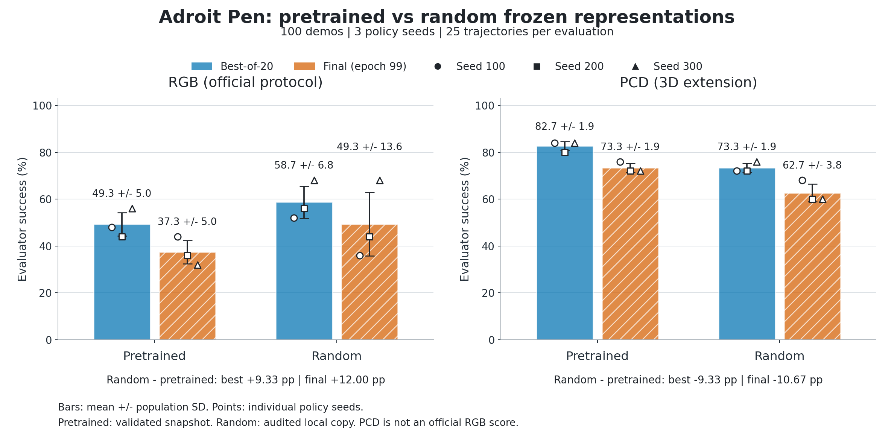
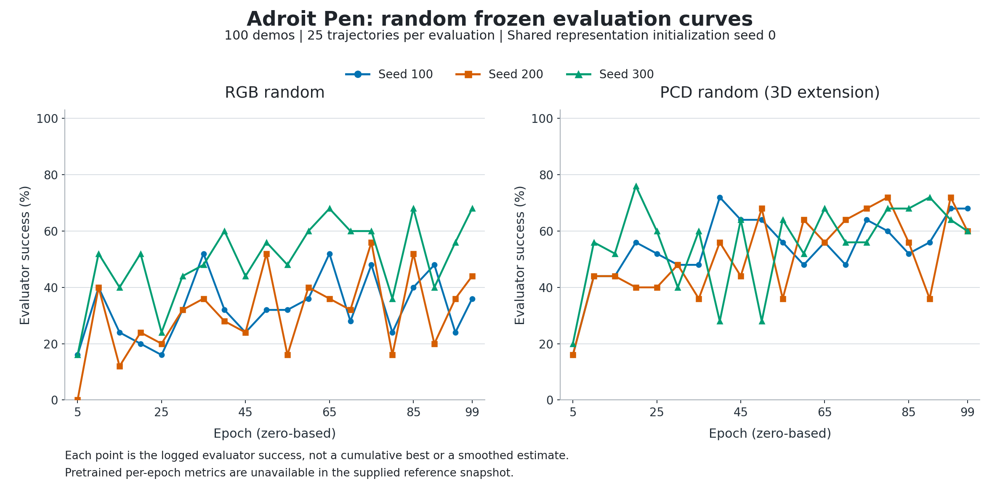

# Pen 100-demo 随机初始化 IL 对照

## 目标与状态

检验 LeWM 预训练是否提高同架构冻结表征的下游 IL 成功率。RGB 和 PCD 分别比较预训练与随机初始化，均使用官方 100 条 expert demonstrations、同样的 BC 动作头和在线 evaluator。

**完成并验收。** 随机流程开始于 2026-10-01 14:48，完成于 22:22（Asia/Shanghai）；含两个 smoke 和六个正式运行，总耗时约 7 小时 34 分钟。参考预训练组的六个正式结果于运行前只读重新验收。当前文档更新从本地完成快照重算随机组指标，并核对 policy SHA。

## 受控变量

| 项目 | 本轮设置 |
|---|---|
| 环境 | `pen-v0`，Adroit，`vil_camera` |
| 下游训练数据 | 100 个官方 demos；PCD 从同一 demos 重放转换，action 保持一致 |
| BC 训练 | 100 epochs，MSE，Adam，学习率 0.001，batch size 256 |
| 动作头 | `BatchNormMLP`，三个 256 宽隐藏层，ReLU，dropout 0 |
| 观测 | 192 维表征，FLARE 历史 3 帧，24 维 proprio；action 24 维 |
| 在线评测 | 每轮 25 条 reset 后闭环轨迹，epochs `5,10,...,95,99` 共 20 轮 |
| policy seeds | `100/200/300`，每轮 evaluator 使用对应 base seed |
| 编码器与 projector | 冻结；随机组原生初始化，初始化 seed 固定为 `0` |
| 主指标 | 每 seed 的 20 轮 `eval/success` 最大值，再对 3 seeds 等权汇总 |
| 次指标 | epoch 99 的 `eval/success` |
| 数值精度 | CPU FP32，与参考运行一致 |
| smoke | 各 100 demos、1 epoch、1 条在线轨迹；仅用于接口验收 |

随机替换范围为 IL 实际调用的 encoder 和 projector。动力学 predictor、action encoder 和规划器不在 BC 决策调用链中，因此其参数是否随机不影响本对照。

## 结果

总体标准差使用 `ddof=0`。差值为 **random − pretrained**，单位为百分点。

| 模态 | Seed | Pretrained best | Random best | Δ best | Pretrained final | Random final | Δ final |
|---|---:|---:|---:|---:|---:|---:|---:|
| RGB | 100 | 48% | 52% | +4 | 44% | 36% | −8 |
| RGB | 200 | 44% | 56% | +12 | 36% | 44% | +8 |
| RGB | 300 | 56% | 68% | +12 | 32% | 68% | +36 |
| RGB | 均值 | 49.3% | 58.7% | **+9.3** | 37.3% | 49.3% | **+12.0** |
| PCD | 100 | 84% | 72% | −12 | 76% | 68% | −8 |
| PCD | 200 | 80% | 72% | −8 | 72% | 60% | −12 |
| PCD | 300 | 84% | 76% | −8 | 72% | 60% | −12 |
| PCD | 均值 | 82.7% | 73.3% | **−9.3** | 73.3% | 62.7% | **−10.7** |





每个正式 seed 验收 100 条 finite loss、20 条 finite eval、epoch 99、exit 0、policy 实际 pickle 加载、policy SHA、resolved config、demo/checkpoint SHA 和数据 QC。随机流程最终 state 为 `finished`，顶层 exit 为 0；监控已删除。完整记录见 [结果 JSON](../results/adroit_pen_100demo_random_control.json)。

## 结论与边界

PCD 预训练组的 Best-of-20 在三个 policy seed 均高于随机组，均值高 9.3 个百分点，Final 均值高 10.7 个百分点。这提供了本次 PCD 冻结表征有用的实验观察。随机 PCD 仍达到 73.3%，说明不能把全部成绩归因于学到的表征。

RGB 预训练组的 Best-of-20 在三个 policy seed 均低于随机组；本轮没有观察到 RGB 预训练带来的收益。其原因尚未验证，不能由此直接判定 RGB 世界模型或预训练范式普遍无效。

一个随机 encoder seed 配合三个 policy seeds，不是三次独立随机 encoder 初始化。policy seed 同时影响 BC 训练与 evaluator reset 集。未做跨初始化重复、proprio-only、跨任务或独立 holdout 评测；不作显著性或泛化结论。

Best-of-20 使用重复的 evaluator seed 集挑选峰值，有选择偏差；Final 也使用同一 seed 集。25 条轨迹使单轮 SR 以 4 个百分点变化。最高 success 的 epoch 未必是实际保存的 `best_policy.pickle`：官方循环在保存点按 return 更新 policy。policy SHA 仅用于产物身份和可加载性验收。

PCD 有深度几何、模拟器 segmentation 和前景裁剪，RGB 没有相同信息预算；因此先比较各模态的预训练与随机组，再讨论模态差异。上游 10k/150 train/test 划分不等价于下游在线 IL 泛化验收。

## 可复现输入

实验源码基于 JEPA4R `86e5ccd9a2d31204b5cd392f9681e182245c6a2a`，加上本轮随机对照改动；实际执行源码 SHA 清单记录于 `preflight.json`。上游官方 train loop 来自 eai-vc `76fe35e87b1937168f1ec4b236e863451883eaf3`。当前开发树另有任务扩展，复现既有数值应核对执行时源码快照及 SHA，不应仅凭分支名判为相同版本。

| 输入 | SHA-256 |
|---|---|
| RGB 100 demos | `cb6e122487f3abaed13e722eec9b4ba59441ea232ccb8a423c7e3a2c5fcfb557` |
| PCD 100 demos | `ba45961e860e3e4b7e184b9a908c80385a6e6b2d336b14d82d93ac4cfc6e089c` |
| RGB epoch-10 参考 checkpoint | `a2d9a034805ea295b6c731e14220d23f74bc80401c0e9f482782dbd027bb71bc` |
| PCD epoch-10 参考 checkpoint | `2e6c846ddb5087b2dff57f0e7af74b0e3193ed30ffbc2c5c839dddfa30d8877a` |
| RGB 随机权重文件 | `ea383f8cdf8236d50868296690cf19303c38be930941c1e039216f712d4e2f65` |
| PCD 随机权重文件 | `3e9c50ec070bce11d72692ae1194f49501ccfc0b65568c30b9f3cdf410dad244` |

环境：Python 3.8.20、PyTorch 1.13.0 CPU、torchvision 0.14.0、mujoco-py 2.0.2.13。随机分支跳过 pretrained weights 的读取，仅使用 checkpoint 配置重建架构。相同初始化重复加载的状态一致，不同 seed 的状态不同；原生 BatchNorm 等 buffer 按默认值初始化。

预检查验证的是 loader 重复性及可冻结性；随后用实际 offline loader 和 `FrozenEmbeddingWrapper` 在独立只读诊断进程核对：两者状态 SHA 一致、合成单帧输出相同、在线 wrapper 参数 `requires_grad=False`。该诊断未检查正在训练进程内的 tensors。源码同时确认 offline 编码在 `no_grad` 下完成，BC optimizer 仅包含 `policy.model.parameters()`。

共享数据盘满时，用户授权随机组写入 `/root/autodl-tmp`；随机权重、配置、日志、metrics 和 policy 已同步 Windows 本地。数据与 checkpoint 本身保持原位置，未为这轮重新采集。

## 复核图表

从仓库根目录运行：

```bash
python scripts/build_adroit_pen_results.py
```

图表由仓库内 JSON 重建。新运行使用 [RGB random 配置](../../lewm_pcd/bench/cortexbench/conf/model/lewm_adroit_pen_2d_random.yaml) 或 [PCD random 配置](../../lewm_pcd/bench/cortexbench/conf/model/lewm_adroit_pen_pcd_random.yaml)，并显式传入 `--num-demos 100 --epochs 100 --eval-frequency 5 --eval-num-traj 25 --seeds 100 200 300`，每次使用新的 output root。

## 公开参考来源

- [官方 Adroit BC 配置](https://github.com/facebookresearch/eai-vc/blob/76fe35e87b1937168f1ec4b236e863451883eaf3/cortexbench/mujoco_vc/visual_imitation/config/Adroit_BC_config.yaml)：100 demos、100 epochs、25 条在线轨迹。
- [官方 train loop](https://github.com/facebookresearch/eai-vc/blob/76fe35e87b1937168f1ec4b236e863451883eaf3/cortexbench/mujoco_vc/visual_imitation/train_loop.py)：周期与最终评测、最高 success 记录、按 return 保存 policy。
- [Behavior Cloning with Information Bottleneck](https://raw.githubusercontent.com/mlresearch/v267/main/assets/bai25e/bai25e.pdf)：PDF 第 19 页 Table 6 提供 Reorient-Pen task-wise 结果；第 6、17、18 页说明训练、融合与选模设置。参考表与本轮未使用完全一致的融合/优化协议，不作为本地复现成绩。
